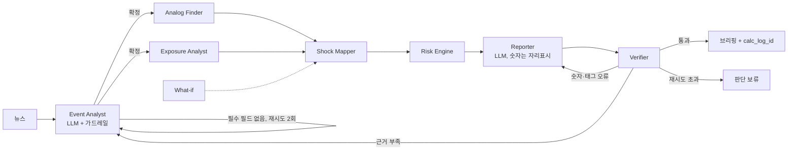

# ShockLens 에이전트 설계서 (2026-11-01)

지경학 뉴스 1건 → KIC형 가상 포트폴리오(12개 바스켓)의 ES97.5·VaR95 변화를 근거와 함께 브리핑하는 멀티 에이전트.
**설계 원칙: 숫자는 코드가, 판단은 LLM이.** LLM은 뉴스 해석(Event Analyst)과 문장 작성(Reporter)에만 쓰고, 그 출력도 코드 가드레일을 통과해야 다음 단계로 간다.

## 1. 전체 흐름

| 구분 | 에이전트 | LLM | 핵심 산출물 |
|---|---|---|---|
| 탐색 | Event Analyst | O (없으면 규칙) | 구조화된 사건 + 근거 문장 id |
| 탐색 | Analog Finder | X | 유사 과거 사건, 경로(direct/relaxed/synthetic), 선택 근거 |
| 탐색 | Exposure Analyst | X | 바스켓별 직접 노출 등급 + 근거 |
| 계산 | Shock Mapper | X | 팩터 충격 3개 시나리오, 고유충격, 자가 점검 경고 |
| 계산 | Risk Engine | X | ES·VaR 3단 분해, 정규MC 비교, 손실 기여, calc_log_id |
| 서술 | Reporter | O (없으면 템플릿) | 브리핑 (숫자 자리표시를 코드가 채움) |
| 검증 | Verifier | 선택 | 통과/반려, 반려 시 담당 에이전트 지정 |

## 2. 헤드쿼터 (LangGraph)

헤드쿼터는 State를 들고 다니며 **코드로 된 게이트 규칙**으로 다음 노드를 정한다. 흐름 결정에 LLM을 쓰지 않으므로 같은 입력이면 같은 경로를 탄다.

| 게이트 | 조건 | 다음 |
|---|---|---|
| 사건 게이트 | 필수 필드(수단·발동국·대상국) 확정 | Analog Finder ∥ Exposure Analyst (병렬) |
| | 필수 필드 없음, 재시도 < 2 | Event Analyst 재실행 (오류 내용을 피드백으로 전달) |
| | 영향 채널을 정할 수 없음 | 사용자에게 가정 요청 후 종료 |
| | 재시도 초과 | 판단 보류 종료 |
| 합류 | Analog Finder와 Exposure Analyst 모두 완료 | Shock Mapper (Exposure 실패 시 "직접 노출 판단 없음"으로 계속) |
| 검증 게이트 | 통과 | 완료 |
| | 숫자·태그·서술 방향 오류 | Reporter 재작성 (지적 사항 전달) |
| | 사건 필수 필드에 뉴스 근거 없음 | Event Analyst 재실행 |
| | 담당별 재시도 2회 초과 | 판단 보류 종료 (문제 목록 + 확보된 결과) |
| What-if | 사용자 가정 문장 | Shock Mapper부터만 재실행 (사건·유사 사례는 재사용) |

State 주요 필드: run_id, seed, sentences, event, analogs, analog_tier, exposure, factor_shock, beta_regime, shock_warnings, risk_result, calc_log_id, facts, sources, draft_brief, final_brief, verification, retries, whatif_overrides, trace(노드별 소요시간·요약).

## 3. 에이전트별 명세

### 3.1 Event Analyst — 뉴스를 '계산 가능한 사건'으로

- **입력/출력:** 뉴스 텍스트 → Event (수단, 방향, 발동국, 대상국, 산업, 단계, 강도 1~5, 영향 채널, 필드별 근거 문장 id, 동시발생 충격, 국부펀드 표적 여부, 불확실 필드)
- **LLM 역할:** 문장마다 번호([s1]…)를 붙여 주고, 정해진 어휘·강도 기준표·예시 1개로 JSON 구조화. 숫자 예측은 금지.
- **코드 가드레일 6개**
  1. 어휘 검사: 수단 7종·단계 5종·국가·산업·팩터 7개 밖의 값은 거절하거나 보정 후 기록
  2. 근거 검사: 존재하지 않는 문장 id 제거, 근거 없는 필드는 `uncertain_fields`로 → 브리핑에 "판단 보류 성격"으로 표시
  3. 채널 보정: 비었거나 어휘 밖이면 수단별 기본 채널표로 채움, 방향(확대/완화)과 위험회피 부호가 모순이면 수정
  4. 단계·방향 일관성: 확대 사건에 '완화' 단계, 관세 유예에 '확대' 방향 같은 모순 수정
  5. 동시발생 충격: LLM 목록 + 거시 키워드(FOMC·고용·물가·침공 등) 스캔을 합침
  6. 국부펀드 표적: 금융제재 + 중앙은행·외환보유액 언급이면 표시
- **실패 처리:** 필수 필드가 비면 규칙 추출로 보충 → 그래도 없으면 헤드쿼터가 오류를 피드백으로 넣어 재실행 → 2회 초과 시 판단 보류
- **LLM 없을 때:** 키워드 규칙 + 조사(을/를, 과/와)로 발동국·대상국 역할 추정. 강도는 항상 불확실로 표시
- **KIC 업무 가치:** 애널리스트가 뉴스마다 "무엇이, 누구에게, 어떤 경로로"를 정리하는 1차 분류를 자동화하고, 판단마다 원문 근거를 남김

### 3.2 Analog Finder — "과거에 비슷한 일이 있었나"

- **입력/출력:** Event → 유사 사건 최대 3건, 경로, 후보 점수표, 제외 사건
- **방법:** 구조 점수 = 수단 0.4 (같으면 1, 같은 계열 0.5) + 산업 0.3 (자카드) + 국가 0.2 (자카드) + 단계 0.1
- **규칙:** 방향(확대/완화) 같은 사건만 / 반응 창에 무관한 큰 충격이 겹친 사건(clean: false) 제외 / 새 사건 날짜보다 미래 사건 제외(사후 정보 누수 방지)
- **경로:** 최고 점수 ≥ 0.7 direct, ≥ 0.4 relaxed, 미만 synthetic(강도 기반 합성)
- **설명 가능성:** 선택한 사건마다 "수단 일치, 국가 일부 일치" 같은 한 줄 근거를 붙여 브리핑의 [src:사건id]로 인용
- **확장:** 설명문 임베딩 유사도를 0.5 비중으로 결합 (본선)

### 3.3 Exposure Analyst — "어느 자산이 직접 맞나"

- **입력/출력:** Event → 바스켓 12개별 직접 노출 high/mid/none + 근거 문장
- **방법:** 노출 매핑표(바스켓 × 국가·산업 등급)와 대조
- **규칙:** 산업을 겨냥한 수단(수출통제·엔티티 리스트)은 국가 일치만으로 high를 주지 않음 → 예: 중국의 대미 희토류 통제는 미국 주식 전체가 아니라 반도체·대만 바스켓이 high
- **실패 처리:** 오류가 나도 "직접 노출 판단 없음"으로 전체 흐름 계속
- **KIC 업무 가치:** 팩터 모델이 놓치는 '직접 표적' 효과(고유충격)를 별도로 잡아 바스켓 단위 대응 논의를 가능하게 함

### 3.4 Shock Mapper — 사건을 팩터 충격으로

- **입력/출력:** Event, 유사 사건, 노출 → 팩터 7개 × mild/central/severe, 바스켓 고유충격, 베타 국면(강도 4 이상 위기 베타), 경고
- **방법:** 유사 사건의 발표 후 3거래일 실제 팩터 반응을 사건 단위로 묶어 사용 (손실 최대 사건 = severe, 최소 = mild, 팩터별 중앙값 = central). 유사 사건이 없으면 강도 → 분위수 표로 합성
- **영향 채널 필터:** 사건과 무관한 팩터는 0, 기대와 반대 부호는 0 (비교 사건 기간에 우연히 움직인 달러·금리가 섞이는 것을 차단)
- **자가 점검 경고:** 과거 최대치 2배 초과 이상치 / 유사 사건 1건이라 범위 추정 불가 / synthetic 경로 / 반대 부호 0 처리 건수 / What-if 배수가 기준 충격 0이라 효과 없음
- **What-if:** "유가 +10%", "반도체 충격 3배" → 팩터 덮어쓰기

### 3.5 Risk Engine — 숫자의 유일한 출처

- **방법:** 블록 부트스트랩(5일 블록, 10,000경로, 20거래일), ES97.5·VaR95
- **3단 분해:** ① 평상시(전체 표본) ② 국면(위기면 VIX 상위 20% 표본) ③ ② + 사건 충격 → 국면 효과(②−①)와 사건 효과(③−②) 분리
- **비교:** 같은 충격을 정규분포 MC로 계산해 ES 과소평가 폭 제시
- **기록:** 입력·출력·시드·데이터 버전을 calc_log에 저장하고 번호(calc_log_id)를 브리핑에 표시 → 같은 입력 같은 결과, 사후 감사 가능

### 3.6 Reporter — 숫자를 쓰지 않는 작성자

- **방법:** LLM은 `{{ES_STRESSED}}` 같은 자리표시만 쓰고, 코드가 Risk Engine 결과로 채움 → 숫자를 지어내거나 잘못 옮길 여지 제거
- **근거 태그:** 뉴스 [src:s3], 과거 사건 [src:cn_ban_us_2024], 계산 [calc]
- **경고는 코드가 항상 첨부:** 동시발생 충격, 국부펀드 표적, synthetic 경로, 이상치, 근거 부족 필드, 제외한 과거 사건
- **구성:** 요약 / 무엇이 일어났나 / 포트폴리오 영향(ES 3단 분해, 시나리오 범위, 손실 기여 상위 3) / 유의사항 / 점검 목록
- **LLM 없을 때:** 같은 구성의 고정 템플릿 (조사·국가명 한글화 포함)

### 3.7 Verifier — 반려권을 가진 검증관

| 검사 | 방법 | 실패 시 |
|---|---|---|
| 남은 자리표시 | `{{...}}` 탐지 | Reporter |
| 숫자 대조 | 본문의 모든 %·%p 숫자가 계산 결과 또는 뉴스 원문에 있는지 (±0.01) | Reporter |
| 숫자 문장 태그 | 숫자가 있는 문장에 [calc]/[src] 필수 | Reporter |
| 근거 id 존재 | [src:id]가 실제 근거 목록에 있는지 | Reporter |
| 무태그 문장 | 소제목 외 본문 문장에 태그가 없으면 | Reporter |
| 서술 방향 | 사건 효과가 +인데 "위험 감소"라고 쓰는 등 | Reporter |
| 사건 근거 | 필수 필드에 뉴스 근거가 없으면 | Event Analyst |
| (선택) 사실 검사 | LLM이 근거로 뒷받침되지 않는 주장 문장 탐지 | Reporter |

## 4. 에이전트별 평가 지표 (본선 검증 계획)

| 에이전트 | 지표 | 방법 |
|---|---|---|
| Event Analyst | 필드별 정확도(수단·국가·단계), 근거 id 적중률 | 라이브러리 13건의 원문 뉴스로 정답과 비교 |
| Analog Finder | 사람이 고른 유사 사건과의 일치율 | 사건별 상위 3건 비교 |
| Shock Mapper·Risk Engine | 방향 적중률, 실제 수익률이 mild~severe 범위에 든 비율 | clean 사건 leave-one-out 백테스트 |
| Reporter·Verifier | 숫자 오류율 0%, 무근거 문장 비율, 재작성 횟수 | 실행 로그(trace) 집계 |
| 전체 | 실행 시간, 판단 보류 비율 | trace |

## 5. 구현 위치

`agents/state.py`(스키마·어휘) · `llm.py`(공급자 전환, 키 없으면 규칙 경로) · `context.py`(모델 데이터) · `event_analyst.py` · `analog_finder.py` · `exposure_analyst.py` · `shock_mapper.py` · `risk_agent.py` · `reporter.py` · `verifier.py` · `hq.py`(LangGraph, What-if) · `run.py`(CLI) · 테스트 `tests/test_agents.py`
