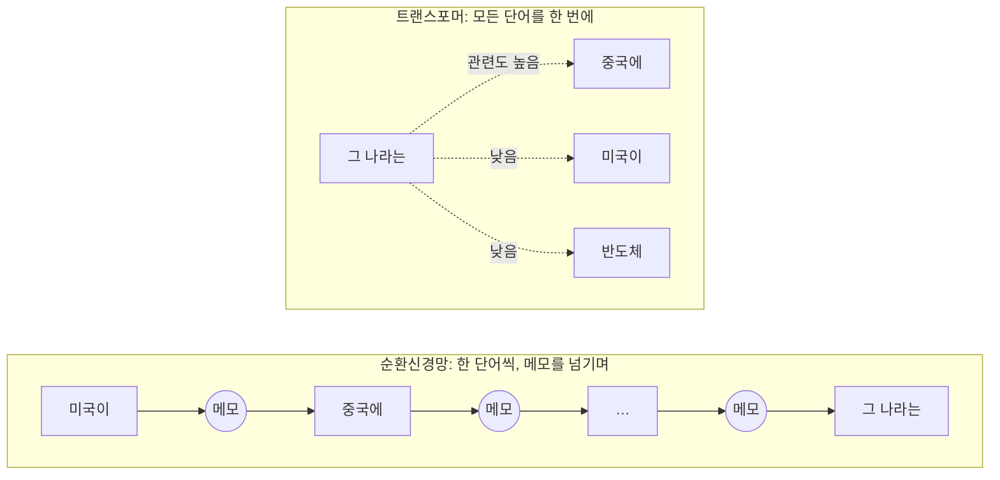
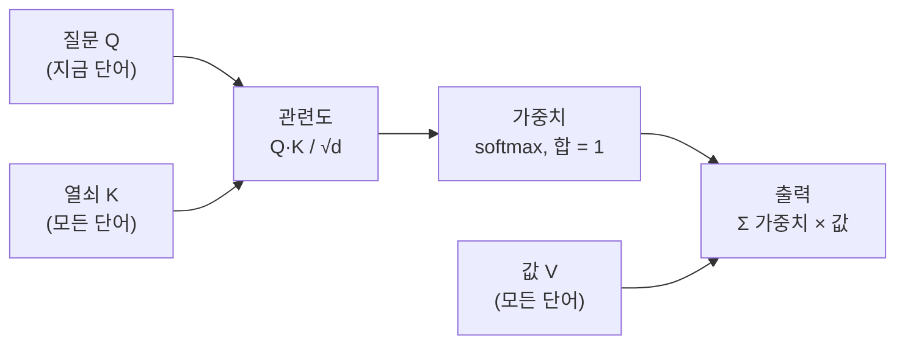
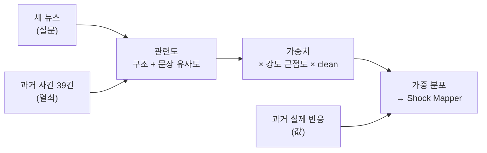

# 어텐션과 트랜스포머, 그리고 ShockLens (2026-11-25)

결론: ShockLens에는 순환신경망(RNN)이 없다. 에이전트가 한 줄로 이어진 것은 작업 흐름(LangGraph)이지 신경망이 아니다. 어텐션은 이미 세 곳에 쓰인다. 학습형 어텐션으로 바꾸는 일은 사건 표본이 수백 건 이상으로 커진 뒤에 검토한다.

## 1. 트랜스포머란

트랜스포머는 문장을 읽을 때, 모든 단어가 다른 모든 단어를 한꺼번에 살펴보고 지금 자기에게 중요한 단어에 더 집중하도록 만든 신경망이다. 이 집중 장치를 어텐션이라 하고, 트랜스포머는 어텐션을 여러 층 쌓은 구조다. Claude, ChatGPT, 문장 임베딩 모델(MiniLM)이 모두 이 구조로 되어 있다.

### RNN과의 차이

| | 순환신경망 (RNN, LSTM) | 트랜스포머 |
|---|---|---|
| 읽는 방식 | 앞에서부터 한 단어씩 순서대로 읽는다 | 문장 전체를 한 번에 펼쳐 놓고 본다 |
| 기억 | 메모 한 장(은닉 상태)에 계속 덮어쓴다. 문장이 길면 앞부분이 흐려진다 | 모든 단어 쌍의 관련도를 직접 잰다. 멀리 떨어진 단어도 놓치지 않는다 |
| 속도 | 앞 단어가 끝나야 다음 단어를 계산할 수 있다 | 단어를 동시에 계산할 수 있다(병렬) |



예: "미국이 중국에 반도체 수출을 막자, 그 나라는 희토류로 맞섰다." "그 나라"가 누구인지는 앞의 "중국"을 봐야 알 수 있다. 어텐션은 "그 나라"가 문장의 모든 단어에 관련도 점수를 매기게 한다. "중국"이 가장 높은 점수를 받고, 그 단어의 정보를 많이 가져와 뜻을 정한다.

## 2. 어텐션 계산: 질문·열쇠·값

각 단어를 벡터로 바꾼 뒤 세 가지 역할을 준다.

- **질문(Query, Q):** 나는 무엇을 찾고 있나
- **열쇠(Key, K):** 나는 이런 정보를 갖고 있다
- **값(Value, V):** 실제로 건네줄 내용

계산은 세 단계다.

1. 관련도 = 질문과 열쇠의 내적 (Q·K). √d로 나눠 크기를 맞춘다.
2. 가중치 = softmax(관련도). 합이 1이 되도록 바꾼다.
3. 출력 = 가중치로 값을 가중평균한다 (Σ 가중치 × V).

```
Attention(Q, K, V) = softmax(Q Kᵀ / √d) V
```



트랜스포머는 이 Q·K·V를 만드는 행렬을 수십억 개 문장으로 학습한다. 무엇에 집중할지를 스스로 배우는 것이다. 이 계산을 여러 개 나란히 돌리고(멀티헤드), 그런 층을 여러 번 쌓으면 트랜스포머가 된다.

## 3. ShockLens에서 어텐션이 쓰이는 곳

| 위치 | 무엇 | 학습 여부 |
|---|---|---|
| Event Analyst, Event Checker, Reporter, 1차 분류 | Claude (Sonnet·Haiku) — 트랜스포머 | Anthropic이 학습한 모델을 그대로 쓴다 |
| Analog Finder 임베딩 층 (`engine/embedsim.py`, 기본 꺼짐) | MiniLM 문장 임베딩 — 트랜스포머 | 공개 모델을 그대로 쓴다(추론만) |
| Analog Finder 가중치 (`engine/analog.py`) | 구조상 어텐션과 같다 (아래) | 학습하지 않는다. 사람이 정한 규칙 |

### Analog Finder = 규칙으로 정한 어텐션

| 어텐션 | Analog Finder |
|---|---|
| 질문 Q | 새 뉴스 (사건 구조 + 기사 문장) |
| 열쇠 K | 사건 라이브러리 39건의 구조·문장 |
| 관련도 Q·K | 점수 = 0.5 × 구조 점수(수단 0.4, 산업 0.3, 국가 0.2, 단계 0.1) + 0.5 × 문장 유사도 |
| 가중치 softmax | 점수 × 강도 근접도 × clean 계수 (합으로 정규화) |
| 값 V | 각 과거 사건의 실제 팩터 반응 |
| 출력 | 가중 분포 → Shock Mapper의 충격 시나리오 |



다른 점은 하나다. 트랜스포머는 관련도를 매기는 기준을 데이터로 학습하고, ShockLens는 사람이 정한 규칙으로 매긴다. 그래서 선택한 사건마다 "수단 일치, 국가 일부 일치" 같은 근거를 [src:사건id]로 보여줄 수 있다.

## 4. 왜 지금은 학습형 어텐션으로 바꾸지 않나

- **표본이 너무 적다.** 사건은 39건이고, 그중 clean은 13건이다. 정답(실제 반응)도 사건당 하나다. 학습형 어텐션 층의 파라미터 수천 개가 사건을 통째로 외워 버린다(과적합). 그러면 백테스트는 좋아 보이고 새 사건에서는 틀린다.
- **설명이 사라진다.** 학습된 가중치는 "왜 이 사건을 골랐는지"를 말해주지 않는다.
- **방향 원칙과 충돌한다.** 2026-11-23 방향 문서에서 성적표가 30건 쌓일 때까지 모델 숫자를 바꾸지 않기로 했다. 엔진을 바꾸면 kfin-eval 정답지도 함께 갱신해야 한다.

### 검토 시점

- 사건 라이브러리가 수백 건 이상일 때 (GDELT·Global Trade Alert 확장)
- 실전 성적표에서 규칙 가중치가 어디서 틀리는지 숫자로 보일 때

그 전에 해볼 수 있는 가장 작은 단계는 지금 점수에 온도(temperature) 하나만 붙인 softmax 가중치다. 파라미터가 하나라 `analog_eval`로 검증할 수 있다. 단, analog_labels.yaml의 정답 라벨 13건을 먼저 채워야 한다.
