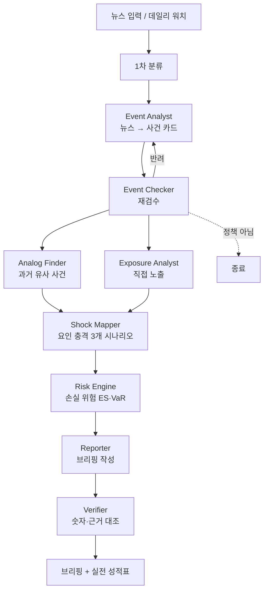

# ShockLens는 어떻게 작동하나 — 처음 보는 사람을 위한 설명 (2026-11-25)

## 한 줄 요약

**지경학 뉴스 한 건을 넣으면, 글로벌 포트폴리오가 얼마나 손실을 볼 수 있는지를 근거와 함께 알려주는 AI 에이전트 팀이다.** 지경학 뉴스는 관세, 수출통제, 제재, 국내 규제·선거 같은 것을 말한다. 포트폴리오는 국부펀드처럼 구성한 12개 자산 묶음이다.

설계 원칙은 하나다. **숫자는 코드가, 판단은 LLM이.** AI(Claude)는 뉴스를 읽고 해석하고 글을 쓰는 일만 한다. 손실 숫자는 전부 정해진 계산 코드가 만들고, 계산할 때마다 기록 번호(calc_log_id)를 남긴다. AI가 숫자를 지어낼 수 없게 하려는 것이다.

---

## 1. 예시로 따라가기

뉴스: *"미국 상무부가 중국 기업이 해외 데이터센터를 통해 첨단 AI칩을 쓰지 못하게 막는 규칙을 발표했다."*

| 순서 | 누가 | 무엇을 하나 | 이 뉴스에서는 |
|---|---|---|---|
| 1 | 1차 분류 | 계산할 만한 정책 사건인지 먼저 거른다 | 정책 사건, 중요도 높음 |
| 2 | Event Analyst | 뉴스를 정해진 칸에 채운 '사건 카드'로 바꾼다 | 수단 = 기술 수출통제, 가해국 = 미국, 대상국 = 중국, 산업 = 반도체 |
| 3 | Event Checker | 다른 AI 모델과 규칙으로 해석을 한 번 더 검사한다 | 근거 문장이 첫 두 문장에 있음 → 통과 |
| 4 | Analog Finder | 과거 사건 39건 중 비슷한 사건을 고른다 | 2019 화웨이 제재, 2024 중국의 미국 반도체 보복 등 |
| 4 | Exposure Analyst | 어느 자산이 직접 맞는지 본다 (4번과 동시에 진행) | 반도체 바스켓, 대만, 미국 주식 |
| 5 | Shock Mapper | 과거 반응으로 7개 시장 요인의 충격을 세 시나리오로 만든다 | 반도체 상대수익 하락, 위험회피 상승 (약함·중간·심함) |
| 6 | Risk Engine | 충격을 얹고 시장 경로를 수만 번 돌려 손실 위험을 잰다 | 평상시 → 지금 시장 상태 → 사건까지 반영한 손실을 차례로 계산 |
| 7 | Reporter | 브리핑을 쓴다. 숫자 자리는 비워 두고 코드가 채운다 | "ES가 x%에서 y%로 상승, 손실 기여 1위는 반도체" |
| 8 | Verifier | 브리핑의 숫자·근거를 계산 기록과 대조하고, 틀리면 돌려보낸다 | 통과 → 최종 브리핑 |

정책 사건이 아니거나 근거가 부족하면 중간에 멈춘다. 이때는 "정책 사건 아님"이나 "판단 보류"로 끝내고, 억지로 숫자를 만들지 않는다.

그림의 칸 하나하나를 '에이전트'라고 부른다. 에이전트마다 맡은 일이 하나씩 있고, 헤드쿼터(LangGraph)가 순서와 갈림길을 관리한다.

---

## 2. 어떤 기술로 만들었나

### 2-1. 단계별 기반 기술

| 단계 | 쉬운 설명 | 기반 기술·방법 | 쓴 도구 |
|---|---|---|---|
| 전체 흐름 관리 | 에이전트 순서, 갈림길, 재시도를 정한다 | 상태 그래프(state graph) 기반 멀티 에이전트 오케스트레이션 | LangGraph |
| 뉴스 해석·검수·글쓰기 | 뉴스를 읽고 칸을 채우고 브리핑을 쓴다 | 대형 언어 모델(LLM, 트랜스포머) + 구조화 출력(JSON 스키마) + 인용 | Claude (Sonnet·Haiku), Anthropic API, Pydantic |
| AI 없이도 동작 | API 키가 없으면 규칙으로 대신한다 | 정규표현식·키워드 사전 기반 규칙 추출 | Python 표준 라이브러리 |
| 과거 유사 사건 찾기 | 구조(수단·산업·국가)와 기사 문장이 비슷한 사건을 고른다 | 가중 유사도 검색. 구조는 자카드 유사도, 문장은 가중 코사인 유사도. 구조상 어텐션과 같다([attention-explained.md](attention-explained.md)) | NumPy. 선택: sentence-transformers(MiniLM) |
| 과거 반응 측정 | 사건 직후 3거래일 동안 시장이 얼마나 움직였나 잰다 | 사건 연구(event study), 위약 검정(placebo test) | pandas |
| 자산이 요인에 얼마나 민감한가 | 각 자산이 달러·금리·유가 등에 얼마나 반응하는지 계수로 잰다 | 릿지 회귀 베타. 축소 강도는 시간 블록 교차검증으로 고른다. 평상시·위기 두 벌 | NumPy, SciPy |
| 지금 시장 상태 판단 | 시장이 조용한지 불안한지 본다 | VIX 5일 평균 상위 20% 규칙 + OFR 금융스트레스지수 | FRED, OFR |
| 손실 위험 계산 | 충격을 얹고 미래 20거래일 경로를 많이 만들어 나쁜 경우의 평균 손실을 잰다 | 블록 부트스트랩, 앙상블(FHS + 극단값 이론 GPD + t-코퓰라, 2국면 마르코프), 기대손실 ES 97.5%·VaR 95% | NumPy, SciPy |
| 비교 기준 | 정규분포를 가정하면 위험을 얼마나 작게 보는지 보여준다 | 정규분포 몬테카를로 | NumPy |
| 거꾸로 묻기 | "손실 x%가 나려면 어떤 충격이 필요한가" | 역스트레스테스트(닫힌 해 + 마할라노비스 거리) | NumPy |
| 숫자 검증 | AI가 쓴 글의 숫자가 계산 결과와 같은지 대조한다 | 자리표시 치환 + 규칙 검증 + 계산 장부(calc_log) | Python |
| 안전 | 기사에 숨은 지시문, 위험한 주소, 악성 XML을 막는다 | 프롬프트 주입 방어(구획 정화), SSRF 차단, 안전한 XML 파싱 | defusedxml |
| 매일 실행·채점 | 매일 핫토픽을 분석하고 3거래일 뒤 맞았는지 채점한다 | RSS 수집 + 토픽 묶기 + 예측 기록(추가만 가능) | Windows 작업 스케줄러 |
| 데모 화면 | 결과를 웹 화면으로 본다 | — | Streamlit |

### 2-2. 핵심 개념 쉽게

- **멀티 에이전트:** 큰 일을 한 AI에게 통째로 맡기지 않는다. 해석, 검수, 검색, 계산, 작성, 검증을 각자 맡은 담당자에게 나눈다. 한 담당자가 틀려도 다음 담당자가 잡을 수 있다.
- **LLM(트랜스포머):** 문장을 읽을 때 모든 단어가 서로의 관련도를 재고, 중요한 단어에 집중하는 신경망이다(어텐션). 자세한 설명은 [attention-explained.md](attention-explained.md).
- **베타(민감도):** "달러가 1% 오르면 이 자산은 몇 % 움직이나"를 나타내는 숫자다. 과거 데이터로 회귀해서 구한다. 릿지 회귀는 표본이 적을 때 계수가 지나치게 튀지 않게 눌러 주는 방법이다.
- **블록 부트스트랩:** 과거 수익률을 5일 단위 덩어리로 잘라 무작위로 이어 붙여, 있을 법한 미래 경로를 많이 만든다. 덩어리로 자르는 이유는 "나쁜 날 다음에 나쁜 날이 오는" 연쇄를 살리기 위해서다.
- **ES(기대손실) 97.5%:** 가장 나쁜 2.5% 경우들의 평균 손실이다. VaR가 "최악 5%의 경계선"이라면, ES는 "그 경계를 넘었을 때 평균적으로 얼마나 잃나"다. 은행 규제(바젤 FRTB)도 ES 97.5%를 쓴다.
- **극단값 이론(GPD)·t-코퓰라:** 정규분포는 큰 손실이 날 확률을 작게 본다. 꼬리만 따로 모형화하고(GPD), 자산들이 "같이 폭락하는" 성질을 따로 넣는(t-코퓰라) 방법이다.
- **3단 분해:** 손실 위험을 평상시 → 지금 시장 상태 → 사건까지 반영, 세 단계로 나눠 보여준다. 그래서 "위험이 오른 이유가 원래 불안한 시장 탓인지, 이 사건 탓인지" 구분할 수 있다.
- **실전 성적표:** 예측을 미리 기록해 두고(나중에 고칠 수 없음) 3거래일 뒤 실제와 비교한다. 방향이 맞았는지, 예측 범위 안에 들었는지를 쌓아서 모델을 평가한다.

### 2-3. 참고한 방법 (원전)

| 방법 | 원전 |
|---|---|
| 어텐션·트랜스포머 | Vaswani et al. (2017), *Attention Is All You Need* |
| 사건 연구 | MacKinlay (1997), *Event Studies in Economics and Finance* |
| 릿지 회귀 | Hoerl & Kennard (1970), *Ridge Regression* |
| 블록 부트스트랩 | Künsch (1989), *The Jackknife and the Bootstrap for General Stationary Observations* |
| FHS + 극단값 이론 | McNeil & Frey (2000), *Estimation of tail-related risk measures for heteroscedastic financial time series: an extreme value approach* |
| EWMA 변동성 (λ = 0.94) | J.P. Morgan RiskMetrics (1996) |
| 국면 전환 모형 | Hamilton (1989), *A New Approach to the Economic Analysis of Nonstationary Time Series and the Business Cycle* |
| 지정학 리스크 지수 | Caldara & Iacoviello, GPR 지수 |

---

## 3. 데이터

| 무엇 | 어디서 |
|---|---|
| 자산 가격 (ETF 13개 → 바스켓 12개) | Yahoo Finance (yfinance) |
| 시장 요인 7개 (위험회피 VIX, 달러, 위안화, 유가, 미 10년 금리, 신용, 기술전쟁) | FRED. 신용은 HYG−IEF, 기술전쟁은 SOXX−SPY로 계산 |
| 위기 지표 | OFR 금융스트레스지수, AI-GPR(지정학 리스크, 보고용) |
| 과거 지경학 사건 39건 | 직접 구축 (`data/library/events.yaml`) |
| 뉴스 | 사용자 입력, Google 뉴스 RSS, GDELT |

## 4. 한계 (솔직하게)

- **과거 사건이 39건뿐이다.** 그중 다른 큰 사건과 겹치지 않은 깨끗한(clean) 사건은 13건이다. 그래서 학습형 모델 대신 사람이 정한 규칙을 쓴다.
- **실전 성적표가 아직 적다.** 2026-11-23 기준 채점 1건이다. 성적표가 30건 쌓일 때까지 모델 숫자는 바꾸지 않는다([direction-2026-11-23.md](direction-2026-11-23.md)).
- **충격을 작게 잡는 경향이 있다.** 첫 채점에서 실제 −0.71%를 −0.25%로 예측했다. 예측 범위 안에는 들었다. 1건이라 아직 결론 내릴 수 없다.

## 5. 더 읽을 문서

- 에이전트별 상세 설계: [agents.md](agents.md)
- 어텐션·트랜스포머와 Analog Finder: [attention-explained.md](attention-explained.md)
- 앞으로 방향: [direction-2026-11-23.md](direction-2026-11-23.md)
- 실행 방법: [../README.md](../README.md)
